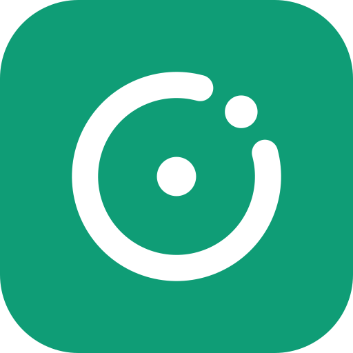

<h1 align="center">OpenAMBike</h1>

Keep using your Ampler e-bike after Ampler: a free app that talks to the bike directly, with no account and no servers of its own.

Unofficial, open-source companion app for Ampler e-bikes. Not affiliated with or endorsed by Ampler Bikes OÜ.

## Contents

- [Why it exists](#why-it-exists)
- [Features](#features)
- [Get started](#get-started)
- [Which bikes it works with](#which-bikes-it-works-with)
- [What it never does](#what-it-never-does)
- [Help and feedback](#help-and-feedback)
- [For developers and researchers](#for-developers-and-researchers)
- [Licence](#licence)

## Why it exists

You bought the bike, so it is yours: it should keep working for as long as you ride it, not for as long as a company stays in business. Ampler Bikes OÜ went bankrupt, and its e-bikes depend on its app and its servers for locking, assist settings and live data.

OpenAMBike is an app for Android and for the Chrome and Edge browsers that talks to the bike over Bluetooth, straight to it. It needs no account, no servers of its own and no permission from anyone: your bike, your key, your phone. It is free and open source, so that nobody can switch it off, make it a subscription or sell your data, and anyone can fix it, improve it or carry it to other bikes.

## Features

Compared with the official Ampler app, **which you still need once, to get your owner key**.

|  | Official | OpenAMBike |
| --- | :-: | :-: |
| Lock and unlock, lights | ✅ | ✅ |
| Assist mode: speed (10 to 25 km/h) and amount (40 to 100 %) | ✅ | ✅ |
| Live speed, motor power, rider power, range and odometer | ✅ | ✅ |
| Battery charge, charge cycles and firmware | ✅ | ✅ |
| Bike's GPS and mobile network on or off, restart, sleep, torque sensor calibration | ✅ | ✅ |
| Works with no account and no servers | ❌ | ✅ |
| Voltage, current, power and temperatures of the battery, and an estimate of its health | Older versions only | ✅ |
| See and copy your key, like a Wi-Fi password | ❌ | ✅ |
| Auto-lock, auto-unlock and auto-ride (Android) | ❌ | ✅ |
| Record rides with their route, exported as GPX (Android) | ❌ | ✅ |
| Works on a computer, in Chrome or Edge | ❌ | ✅ |
| Localization | ❌ | ✅ |
| Firmware updates, factory motor calibration | ✅ | ❌ by choice ([what it never does](#what-it-never-does)) |
| Communication with Ampler's servers | ✅ | ❌ |

## Get started

1. **Get your bike's owner key, while the official Ampler app still connects to your bike.** The key is a secret text of 28 characters, and OpenAMBike needs it to connect. [Getting your owner key](docs/owner-key.md) shows how, step by step, with an Android phone. Do this first: once the official app stops working, there is no known way to get the key.
2. **Install the app.** On an Android phone, download `OpenAMBike-<version>.apk` from the newest [release](https://github.com/Rapsssito/openambike/releases) and open it; [the app's guide](app/README.md#install-it-on-an-android-phone) walks through each screen of the installation. On a computer, the app runs in Chrome or Edge: see [Use it in a browser on a computer](app/README.md#use-it-in-a-browser-on-a-computer).
3. **Connect.** Close the official app, open OpenAMBike, give it your key, and choose your bike: [Connect to your bike for the first time](app/README.md#connect-to-your-bike-for-the-first-time).

## Which bikes it works with

The app is tested on a Stellar of 2022 (second generation, firmware 3.9.0). Other models, generations and firmware versions have not been tried yet: if you try one, tell us how it went in an [issue](https://github.com/Rapsssito/openambike/issues).

## What it never does

- Update the bike's firmware.
- Raise the assist speed above 25 km/h or the motor power above the bike's own maximum, or enable speed pedelec settings.
- Send the bike a command that has not been documented and tested.
- Send your data anywhere. The only thing the Android app downloads is the map of a ride you open, from OpenFreeMap; that tells OpenFreeMap your IP address and the area shown, nothing else.

The reasons, and the legal basis of the project, are in [docs/safety.md](docs/safety.md).

## Help and feedback

Something does not work, or you would like something added? See [When something goes wrong](app/README.md#when-something-goes-wrong), then open an [issue](https://github.com/Rapsssito/openambike/issues). Never post your owner key or a bug report file publicly.

## For developers and researchers

OpenAMBike is also an open specification of the bikes' Bluetooth Low Energy (BLE) protocol, written from captures of the official app's traffic, from analysis of the official app, and from tests on a real bike. The app is built on it.

- **Learn the protocol, or extend it to another bike or firmware:** read [docs/protocol.md](docs/protocol.md), then [reverse-engineering/README.md](reverse-engineering/README.md) for how it was found and the Python tools that talk to a bike from a computer. Captures from other models and generations are the most useful contribution.
- **Improve the app:** read [app/DEVELOPMENT.md](app/DEVELOPMENT.md) and [CONTRIBUTING.md](CONTRIBUTING.md).
- **What is left to find out and to build:** [docs/roadmap.md](docs/roadmap.md).

Before sending anything to a bike, read [docs/safety.md](docs/safety.md).

| Path | What it holds |
| --- | --- |
| [app/](app/) | The app, for Android and the web: [how to use it](app/README.md), [how to build it](app/DEVELOPMENT.md) |
| [docs/protocol.md](docs/protocol.md) | The BLE protocol specification, the project's reference: the app and the tools implement it |
| [docs/owner-key.md](docs/owner-key.md) | How to get your bike's owner key from your phone |
| [docs/safety.md](docs/safety.md) | What the project never does, private data, the legal basis, the name |
| [docs/roadmap.md](docs/roadmap.md) | What is left to find out and to build, by priority, and open questions |
| [reverse-engineering/](reverse-engineering/) | How the protocol was found, the tools it needs, Python tools that talk to the bike |
| [CONTRIBUTING.md](CONTRIBUTING.md) | How to contribute: checks, commits, private data |
| `AGENTS.md` files | Instructions for AI coding agents working on the repository; people can skip them |

## Licence

AGPL-3.0: see [LICENSE](LICENSE). Anyone who distributes a modified version, or lets people use it over a network, must publish its code under the same licence.

AMPLER is a registered trademark of Ampler Bikes OÜ, used here only to say what the project is compatible with.
