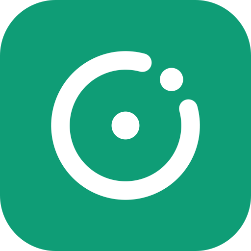

<p align="center"></p>

OpenAMBike lets you use your Ampler e-bike from your phone, over Bluetooth, without Ampler's app, servers or account. This guide shows how to install it and connect it to your bike; from there, the app explains itself.

Unofficial, open-source companion app for Ampler e-bikes. Not affiliated with or endorsed by Ampler Bikes OÜ.

## Contents

- [What you need](#what-you-need)
- [Install it on an Android phone](#install-it-on-an-android-phone)
- [Use it in a browser on a computer](#use-it-in-a-browser-on-a-computer)
- [Connect to your bike for the first time](#connect-to-your-bike-for-the-first-time)
- [When something goes wrong](#when-something-goes-wrong)
- [Your privacy](#your-privacy)
- [Building or changing the app](#building-or-changing-the-app)

## What you need

- **Your bike's owner key.** It is a secret text of 28 characters that the official Ampler app keeps on your phone. You can only get it while the official app still connects to your bike: follow [Getting your owner key](../docs/owner-key.md) first. Without it, OpenAMBike cannot connect.
- **An Android phone** (Android 7 or later) with Bluetooth, or **a computer** with Bluetooth and the Chrome or Edge browser. iPhones are not supported.
- **Your bike nearby and switched on.**

## Install it on an Android phone

1. On your phone, open the [releases page](https://github.com/Rapsssito/openambike/releases) and find the newest release, at the top.
2. Under "Assets", tap `OpenAMBike-<version>.apk` to download it.
3. Open the downloaded file, from the notification or from the Files app.
4. If the phone says it cannot install apps from this source, tap "Settings", allow it for the app you downloaded with (your browser or Files), and go back.
5. Tap "Install". If Google Play Protect warns that it does not know the app, tap "More details", then "Install anyway": the app is not in the Play Store, so Google has not scanned it.
6. Open OpenAMBike from your app list.

To update, download and install the newest APK in the same way: it installs over the old one and keeps your key.

## Use it in a browser on a computer

The app also runs in Chrome or Edge, on a computer with Bluetooth. It is not hosted online yet, so you run it from your own computer, once:

1. Install [Node.js](https://nodejs.org/) version 26 and [Git](https://git-scm.com/downloads).
2. Open a terminal (on Windows, "Command Prompt" or "PowerShell"; on macOS, "Terminal") and run these commands, one at a time:

   ```sh
   git clone https://github.com/Rapsssito/openambike.git
   cd openambike
   npm install
   npm run dev --workspace=app
   ```

3. Open <http://localhost:8100> in Chrome or Edge.

The next time, open a terminal in the `openambike` folder and run only `npm run dev --workspace=app`. To stop it, press Ctrl+C in the terminal.

## Connect to your bike for the first time

1. **Close the official Ampler app** on every phone near the bike. The bike talks to one app at a time.
2. Open OpenAMBike and give it your owner key, in one of two ways:
   - type or paste it in the field, or
   - tap "Read from a bug report" and choose the bug report you saved while [getting your key](../docs/owner-key.md): the app finds the key in it.
3. Tap "Connect". On Android, choose your bike in the list of bikes nearby; in a browser, choose it in the browser's window.
4. On Android, the first time, the phone asks for a 6-digit code to pair: type the code your bike shows.
5. The app shows each step (connect, check the key, read the bike), then opens the bike's controls.

The app keeps your key, encrypted, on that phone or computer. From then on it opens on the bike's controls and, on Android, connects by itself; in a browser, tap "Connect". Tap the connection status at the top to see how it stands, or to disconnect.

### Record your rides

On Android, the Rides tab records a ride from "Start ride" to "Stop ride": its time, distance, speed and power, and its route on a map. It records with the phone's GPS whether the bike is connected or not, and fills in the bike's figures while it is; it goes on with the screen off or the app closed, with a silent notification that shows the ride's time and distance, also on the lock screen, and a button to pause or resume it. The first time, Android asks whether the app may use your location. Stops are left out of the moving time by themselves, and "Pause" leaves out whatever time you choose. Tap the ride being recorded, or start one, to see it over the whole screen as it goes, with its map, figures and charts, and "Pause" and "Stop ride"; go back to see the history. Each ride stays in the history, with its map and charts; "Export" gives it as a GPX file to another app (OsmAnd, Organic Maps, Komoot, Strava), and "Export all" gives the whole history in one file.

### Connect, lock and record by itself

On Android, under Settings, "Automatic" (a browser shows them greyed out, since only the Android app keeps working with the app closed). Auto-unlock appears once auto-lock is on. Settings works with the bike away too, so that you can turn them off without connecting:

- **Auto-lock** connects to your bike by itself when you are next to it, even with the app closed, and locks it when you walk away from it. It never locks it while it moves, and never unlocks it. If the connection drops before it could lock, as you walk away or without coming back within 30 seconds, a notification says so: check the bike. A connection back within the 30 seconds carries on as if it had not dropped.
- **Auto-unlock**, with auto-lock on, unlocks your bike when you come next to it, whether the app connected by itself or you opened it first. It does so whenever your phone comes within about 1.5 m, even if you don't mean to ride, as with the bike parked beside your home; it locks again when you walk away. The app asks you to confirm before turning it on. If you lock the bike in the app yourself, it stays locked until you unlock it in the app or walk away from it: the next time you come back, auto-unlock unlocks it as usual.
- **Auto-ride** connects to your bike by itself when you are next to it, even with the app closed, and starts recording a ride once you have pedalled and the bike has moved for 5 seconds, even with the app closed (wheeling the bike starts none), and stops it when you walk away, after 15 minutes standing, or when the connection is lost as you walk away or for 30 seconds; the minutes standing are not part of the ride. A ride you start yourself, you stop yourself. Android asks whether the app may use your location "all the time", which gives the rides it starts with the app closed their route; without it, they have the bike's figures and no map, and Settings says so under auto-ride, with a button to allow it.
- While auto-lock or auto-ride is on, the app connects to your bike by itself when you are next to it and disconnects when you walk away, which we call auto-connect. Android needs it to show a notification, which stays small and silent at the bottom of your notifications; Android asks once whether the app may show notifications.
- It works the same with the app open or closed. After it lets the bike go as you walk away, the app waits for you to come back rather than connect again; tap "Connect" to connect anyway.
- "History", under the options, shows the signal between your phone and the bike, and the last things auto-connect did and why, with their times; "Show all" lists the rest.
- If the bike stands next to you for 15 minutes, as in a garage beside your home, auto-connect locks it (with auto-lock on), disconnects and pauses, so that the bike can sleep. It turns back on by itself about 30 seconds after you leave, when you ride the bike again, or when you tap "Connect". Disconnecting in the app (tap the connection status at the top) pauses it too, until you tap "Connect": while auto-lock or auto-ride is on, the button says "Disconnect and pause auto-lock and auto-ride".

Tap (i) beside each to read what it does.

How they decide, with the signal as your phone hears it (other phones may hear it stronger or weaker):

| What | When | While the bike moves |
| --- | --- | --- |
| Connect | The bike's signal stays above −72 dBm (about 1.5 m, phone in a pocket) for 5 seconds | Same |
| Reconnect after a drop | Within 30 seconds of the drop, unless it dropped as you walked away, as soon as the signal is above −76 dBm; it carries on as before, with no unlock | Same |
| Auto-unlock | Right after connecting because you came near, or once the signal is that strong on a connection you made by opening the app, if the bike is locked; never while a lock you pressed in the app holds | Same |
| Auto-lock | The signal falls below −76 dBm (about 2.5 to 3 m, or a closed door or wall between you) for 3 seconds, after it was stronger; it locks, then disconnects | Never locks while the bike moved in the last 5 seconds: it waits until the bike has stood still that long |
| Standing still | After 15 minutes with the bike standing, it locks (with auto-lock on), disconnects and pauses; it turns back on 30 seconds after you leave, when you ride, or when you tap "Connect" | The 15 minutes start again |
| Auto-ride starts | Once the bike has moved for 5 seconds from when you pedal | — |
| Auto-ride stops | When auto-connect lets the bike go (you walked away, or 15 minutes standing still), when the connection drops as you walk away or for 30 seconds, or when you disconnect in the app | Keeps recording |

## When something goes wrong

- **The app does not find the bike:** make sure the bike is on and near you, that Bluetooth is on, and that the official Ampler app is closed, also on other phones. On Android, allow the app's request to find nearby devices.
- **The bike refuses the key:** check that you copied all 28 characters. If the key came from a bug report, make sure the official app had connected to the bike while the Bluetooth log was on ([Getting your owner key](../docs/owner-key.md), "If it does not work").
- **"It did not confirm the change":** the bike received it but did not make it, as with the lights while it charges. Try again in a moment.
- **Anything else:** describe it in an [issue](https://github.com/Rapsssito/openambike/issues). Never post your owner key there.

## Your privacy

- The app talks to your bike, and has no account and no server of its own. The only thing it downloads is the map of a ride you open, from OpenFreeMap, a free map service built on OpenStreetMap: that tells OpenFreeMap your phone's IP address and the area shown, nothing else.
- Your rides stay on your phone, until you export them yourself. The app uses your location only while it records a ride; "all the time" only lets auto-ride record a ride it started with the app closed. Android's backup keeps them, to the cloud only when your phone encrypts it (with a screen lock), and moves them to a new phone.
- Your owner key stays on your device, encrypted. Android's backup keeps a copy of it, with your automatic options (auto-connect, auto-lock, auto-unlock, auto-ride), so that a new phone restored from it connects to your bike as before: to the cloud only when your phone encrypts the backup with your screen lock, and in a direct transfer to a new phone. Nothing else of the app goes into the backup. That copy is not encrypted on the phone itself, only kept in the app's own storage, which other apps cannot read; on a rooted phone, it could be. For a phone with no backup or a browser, Settings, "Owner key", shows your key and copies it, to paste in the other device.
- Auto-connect keeps a copy of your key on the phone, encrypted, to connect with the app closed; turning it off removes it.
- Keep your key secret: anyone who has it can unlock and control your bike.
- The app never updates the bike's firmware, never raises the assist above 25 km/h or the motor above its own maximum, and sends the bike only commands that are documented and tested ([docs/safety.md](../docs/safety.md)).

## Building or changing the app

How the app is built, tested and released, and how it works inside, is in [DEVELOPMENT.md](DEVELOPMENT.md).
